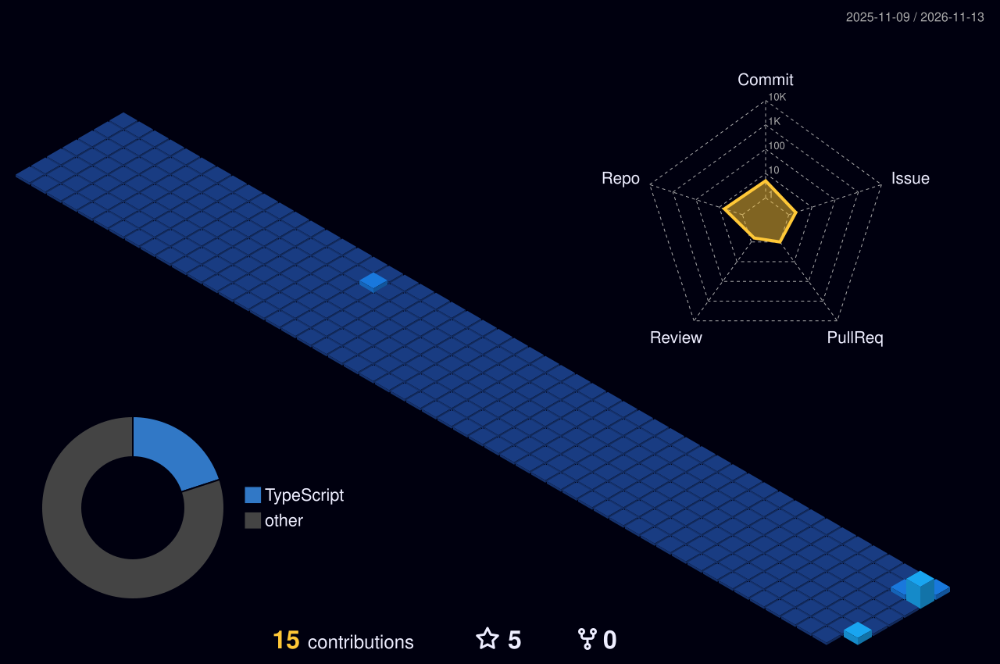

<!-- Rename to README.md in the repo: roblucciroblucci1324-commits/roblucciroblucci1324-commits -->

<div align="center">


<a href="https://github.com/roblucciroblucci1324-commits">
  
</a>

<br/>


</div>

---

## 🗂️ AGENT DOSSIER — `CLASSIFIED`

```js
const agent = {
  codename:  "roblucciroblucci1324-commits",
  division:  "Cipher Pol Aigis Zero (CP0)",
  creed:     "Absolute Justice, shipped in production",
  partner:   "Hattori 🕊️",
  missions:  ["AI agents", "browser automation", "OSINT tooling", "GPU / Kubernetes"],
  training:  ["Rust", "Go", "Python", "agentic workflows with Claude"],
  status:    "ACTIVE — under the World Government's radar ⚡",
};
```

---

## 🥋 Rokushiki — Six Powers (Tech Stack)

| Technique | Power | Weapon |
|---|---|---|
| **Tekkai** 鉄塊 | Iron-body safety, nothing gets through | 🦀 Rust |
| **Soru** 剃 | Blinding speed | 🐹 Go |
| **Shigan** 指銃 | Quick, precise finger-pistol strikes | 🐍 Python |
| **Rankyaku** 嵐脚 | Slashes cleanly across the web | TypeScript / JS |
| **Geppo** 月歩 | Leaps between environments | 🐳 Docker |
| **Kami-e** 紙絵 | Bends around any load | ☸️ Kubernetes |
| **Rokuogan** 六王銃 | The ultimate move | 🤖 Claude |

<div align="center">


</div>

---

## 🌐 3D Contribution City — *Enies Lobby*

<div align="center">



</div>

> Rebuilt daily by `.github/workflows/profile-3d.yml`.

---

## 📊 Mission Report

<div align="center">


</div>

---

## 📈 Surveillance Log

<div align="center">


</div>

---

<div align="center">

<a href="https://github.com/roblucciroblucci1324-commits"></a>
<!-- <a href="https://linkedin.com/in/YOU"></a> -->

<i>“Justice must be carried out, even in the dark.” 🕊️</i>

</div>


